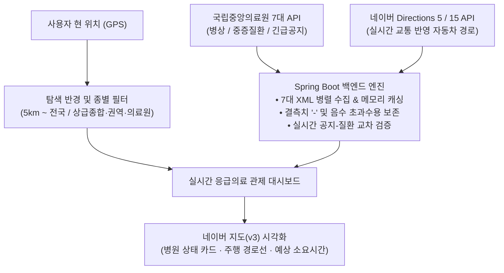
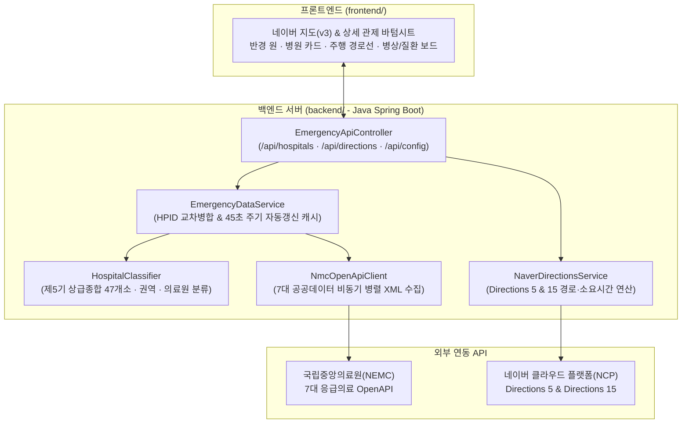
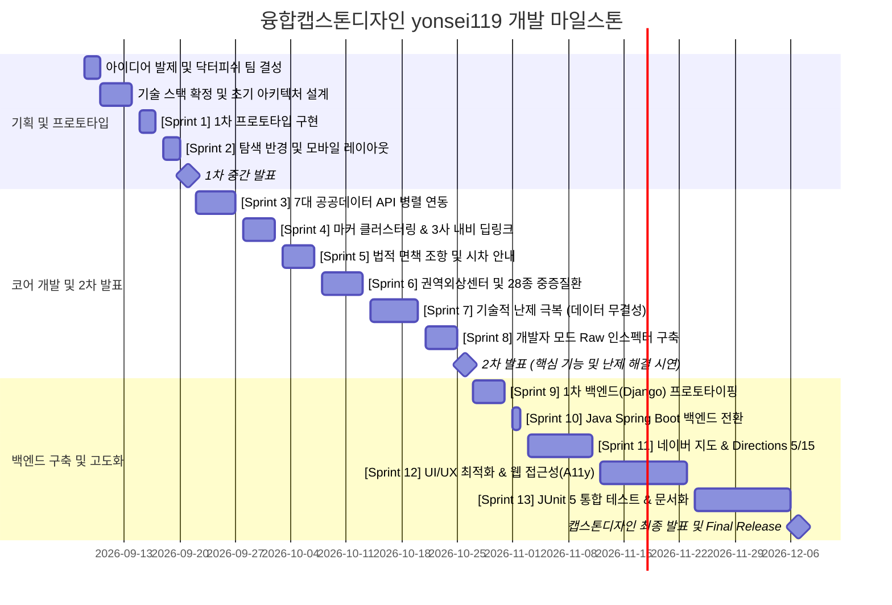

# 융합캡스톤디자인: 응급실 핑퐁 방지를 위한 위치 기반 실시간 응급의료 최적 추천 서비스

<div align="center">


**위치 기반 실시간 응급의료기관 최적 추천 · 다차원 의료 자원 인스펙션 · 네이버 자동차 경로(Directions 5/15) 관제 시스템**  
*저장소 명칭: `yonsei119` · 개발 팀명: `닥터피쉬 (Doctor Fish)`*

</div>

---

## 목차
1. [지도교수 및 팀 구성원](#1-지도교수-및-팀-구성원)
2. [프로젝트 폴더 구조](#2-프로젝트-폴더-구조)
3. [프로젝트 배경 및 목표](#3-프로젝트-배경-및-목표)
4. [선행 벤치마킹 및 차별성 분석](#4-선행-벤치마킹-및-차별성-분석)
5. [시스템 아키텍처 및 핵심 API](#5-시스템-아키텍처-및-핵심-api)
6. [프로젝트 타임라인 (2026.09.08 ~ 2026.12.07)](#6-프로젝트-타임라인-20260908--20261207)
7. [3대 기술적 난제 및 자체 해결 전략](#7-3대-기술적-난제-및-자체-해결-전략)
8. [주요 기능 및 UX/성능 최적화](#8-주요-기능-및-ux성능-최적화)

---

## 1. 지도교수 및 팀 구성원

### 지도교수

<div align="center">

| 교수명 | 소속 / 직함 |
| :---: | :---: |
| **최병관** | 연세대학교 미래캠퍼스 소프트웨어학부 교수 |

</div>

### 팀 구성원 및 역할 (팀명: 닥터피쉬)

<div align="center">

| 이름 | 학과 | 학번 | 담당 역할 |
| :---: | :---: | :---: | :---: |
| **김관호 (팀장)** | 소프트웨어학과 | 2021245078 | 프론트엔드 코어 아키텍처 및 반응형 인터페이스 구현<br>Spring Boot 백엔드-프론트엔드 통합 및 레이아웃 최적화<br>바텀시트 제스처 UX 및 웹 접근성(WCAG 2.1) 설계 |
| **이재원** | 소프트웨어학과 | 2023245138 | 국립중앙의료원 7대 API 백엔드 병렬 수집 및 메모리 캐시 구축<br>네이버 지도(v3) 및 Directions 5/15 실시간 경로·소요시간 개발<br>3대 내비게이션(네이버/카카오/티맵) 딥링크 라우터 구현 |
| **장안나** | 컴퓨터정보통신공학부 | 2020253074 | 공공데이터 XML 명세서(V13) 전수 분석 및 매핑 테이블 수립<br>상급종합병원(47개소) 분류기 및 중증질환-공지 교차 검증 설계<br>결측치(`-`) 및 음수 초과수용 데이터 무결성 정합성 검증 |

</div>

---

## 2. 프로젝트 폴더 구조

하나의 저장소 안에 사용자 화면을 담당하는 **프론트엔드(`frontend/`)**와 데이터 수집·가공을 담당하는 **백엔드 서버(`backend/`)**를 함께 구성한 통합 웹 프로젝트입니다.

```text
yonsei119/
├── frontend/                           # 프론트엔드 화면 (HTML5 / CSS3 / Vanilla JS)
│   ├── Assets/                         # 화면 아이콘 및 참고 이미지 폴더
│   ├── index.html                      # 메인 웹 페이지 (지도, 필터 바, 상세 정보창)
│   ├── style.css                       # PC 및 모바일 반응형 스타일시트
│   └── app.js                          # 지도 렌더링, 병원 검색, 주행 경로선 스크립트
├── backend/                            # 백엔드 서버 (Java 17 + Spring Boot)
│   ├── build.gradle                    # 백엔드 의존성 및 프론트엔드 통합 빌드 설정
│   └── src/
│       ├── main/
│       │   ├── java/com/yonsei119/
│       │   │   ├── Yonsei119Application.java       # 스프링 부트 서버 메인 실행 파일
│       │   │   ├── config/
│       │   │   │   ├── Yonsei119Properties.java    # 환경설정 값(API 키, 캐시 주기) 관리
│       │   │   │   └── WebConfig.java              # 프론트엔드 파일 연결 및 CORS 설정
│       │   │   ├── controller/
│       │   │   │   └── EmergencyApiController.java # 프론트엔드 요청 처리 API 컨트롤러
│       │   │   ├── dto/                            # 응답 데이터 형식(DTO) 모음
│       │   │   └── service/
│       │   │       ├── HospitalClassifier.java     # 상급종합·권역·의료원 자동 분류기
│       │   │       ├── NmcOpenApiClient.java       # 7대 공공데이터 병렬 수집 및 XML 해석기
│       │   │       ├── EmergencyDataService.java   # 병원 데이터 통합 및 메모리 캐시 서비스
│       │   │       └── NaverDirectionsService.java # 네이버 자동차 길찾기 및 소요시간 서비스
│       │   └── resources/
│       │       └── application.yml                 # 서버 포트(8080) 및 외부 API 키 설정
│       └── test/java/com/yonsei119/
│           └── Yonsei119BackendTests.java          # 백엔드 핵심 기능 자동화 테스트 (JUnit 5)
├── Dockerfile                          # 클라우드 배포용 도커(Docker) 빌드 설정
├── render.yaml                         # 클라우드 자동 배포 설정 파일
├── settings.gradle                     # Gradle 프로젝트 구성 파일
└── build.gradle                        # 전체 프로젝트 빌드 및 실행(bootRun) 설정
```

---

## 3. 프로젝트 배경 및 목표

### 1. 응급실 핑퐁(재이송) 문제의 심각성
* 야간 및 공휴일 등 의료 취약 시간대에 응급 환자가 발생했을 때, 병원의 수용 거부나 전문의 부재로 인해 구급차가 여러 병원을 전전하다 골든타임을 놓치는 **'응급실 핑퐁(재이송)'** 현상이 사회적 재난으로 대두되고 있습니다.
* 환자 보호자는 다급한 상황에서 어느 병원에 가야 즉시 처치를 받을 수 있는지 알지 못해 단순 포털 검색이나 119 문의에만 의존하게 됩니다.

### 2. 핵심 목표: "단순 거리순이 아닌 실시간 수용 가능성 및 실도로 소요시간 기반 최적 추천"
* **Java Spring Boot 백엔드 서버**를 통해 국립중앙의료원(NEMC) 실시간 OpenAPI와 **네이버 지도(NAVER Maps v3) 및 Directions 5/15 자동차 경로 API**를 연동합니다.
* **\[실시간 도로 주행 소요시간(ETA) + 현재 잔여 병상 수 + 증상별 처치 가능 여부 + 현장 긴급 공지\]**를 종합 연산하는 **위치 기반 실시간 응급의료 최적 추천 서비스**를 구축합니다.
* AI 생성 코드의 오류를 극복하고 원시 데이터의 무결성을 확보하여, 응급환자와 의료진 모두에게 가장 신뢰할 수 있는 정보를 제공합니다.



---

## 4. 선행 벤치마킹 및 차별성 분석

<div align="center">
  <a href="https://mediboard.nemc.or.kr/" target="_blank">
    
  </a>
  <br>
  <strong><a href="https://mediboard.nemc.or.kr/" target="_blank">중앙응급의료센터 응급의료포털 대시보드 (내 손안의 응급실)</a></strong>
  <p>전국 응급실 실시간 가용 병상 현황 및 중증 응급환자 수용 가능 정보를 제공하는 국가 공식 대시보드</p>
</div>

<div align="center">

| 비교 항목 | 기존 공식 대시보드 (E-Gen) | 본 프로젝트 (`yonsei119`) |
| :---: | :---: | :---: |
| **데이터 응답 속도** | 페이지 전환 시마다 개별 조회로 로딩 지연 | **Spring Boot 사전 로딩 및 메모리 캐싱으로 즉시(0.05초 내) 응답** |
| **지도 시각화** | 단순 리스트 및 텍스트 위주, 위치 파악 지연 | **네이버 지도(v3) 다크/일반 관제 뷰, 클러스터링 및 반경 원 표출** |
| **경로 및 소요시간** | 단순 직선거리 표기 또는 길찾기 연계 미흡 | **네이버 Directions 5/15 주행 경로선, 예상 소요시간(분) 및 3사 내비 연동** |
| **검색 반경** | 행정구역(시·도/구·군) 단위 정적 조회 | **내 위치 기준 5km / 10km / 20km / 50km / 100km / 전국 동적 탐색** |
| **데이터 무결성** | 결측치 및 기준 차이에 대한 설명 부재 | **결측치(`-`) vs `0`석(만실) vs 음수(`초과수용`) 분리, '개발자 모드' 공개** |
| **교차 검증** | 공지사항과 질환 수용 여부가 분리 표기됨 | **실시간 긴급 공지를 파싱하여 차단된 질환을 `[불가능]`으로 자동 전환** |

</div>

---

## 5. 시스템 아키텍처 및 핵심 API

### 1. 백엔드-프론트엔드 통합 아키텍처



### 2. 백엔드 내부 REST API 명세 (`EmergencyApiController`)

<div align="center">

| HTTP 경로 | 담당 클래스 | 주요 기능 |
| :---: | :---: | :---: |
| `GET /api/config` | `EmergencyApiController` | 네이버 지도 클라이언트 ID, 다크모드 스타일 ID 및 기본 출발 좌표 반환 |
| `GET /api/hospitals` | `EmergencyDataService` | 전국 530여 개 응급의료기관 통합·분류 완료 데이터 반환 (`?refresh=true` 지원) |
| `GET /api/directions` | `NaverDirectionsService` | 출발지~병원 간 네이버 Directions 5/15 주행 경로선, 예상 소요시간, 요금 반환 |
| `GET /api/health` | `EmergencyApiController` | 서버 가동 상태(`UP`) 및 런타임 정보 확인용 헬스체크 엔드포인트 |

</div>

### 3. 국립중앙의료원 7대 OpenAPI 비동기 병렬 파이프라인 (`NmcOpenApiClient`)

<div align="center">

| 오퍼레이션 명 | 서비스 기능 | 수집 및 활용 목적 |
| :---: | :---: | :---: |
| `getEgytListInfoInqire` | **응급의료기관 목록정보** | 전국 응급의료기관 마스터 데이터, 고유코드(`HPID`) 및 WGS84 좌표 확보 |
| `getEgytBassInfoInqire` | **응급의료기관 기본정보** | 응급실 대표전화, 인허가 병상 규모 및 진료과목 데이터 |
| `getEmrrmRltmUsefulSckbdInfoInqire` | **실시간 가용병상정보** | 일반/소아/격리/중환자실/입원실 가용 병상(`hvec` 등) 및 11종 장비 현황 |
| `getEmrrmSrsillDissMsgInqire` | **응급실/중증질환 메시지** | 실시간 진료 제한, 장비 점검, 전문의 부재 등 현장 긴급 공지 수신 |
| `getSrsillDissAceptncPosblInfoInqire` | **중증질환자 수용가능정보** | 뇌출혈, 심근경색, 대동맥, 투석 등 28종 중증질환별 처치 가능 여부 |
| `getStrmListInfoInqire` | **권역외상센터 목록정보** | 전국 권역외상센터 지정 기관 식별 및 마스터 정보 확보 |
| `getStrmBassInfoInqire` | **권역외상센터 기본정보** | 권역외상센터 상세 운영 정보 및 외상전용 병상/수술실 데이터 연동 |

</div>

---

## 6. 프로젝트 타임라인 (2026.09.08 ~ 2026.12.07)



### 1. 2026.09.08 — 최초 기획 및 팀 결성
* **아이디어 브레인스토밍**
  * 김관호: 위치 기반 공공데이터 연계 야간/공휴일 응급실 실시간 가용 병상 안내 서비스 제안
  * 이재원: 흉부 X-Ray 데이터셋 기반 폐렴 및 호흡기 질환 감지 AI 모델 제안
  * 장안나: 웹캠 모션 트래킹 기반 체형 불균형(척추·경추 각도) 진단 서비스 제안
* **최종 주제 확정**: 사회적 시급성과 실시간 데이터 연계 가치가 높은 '위치 기반 응급실 최적 추천 서비스' 선정 (팀명: **닥터피쉬**)

### 2. 2026.09.10 — 초기 아키텍처 설계 및 역할 분담 확정
* OS 종속성 없이 모바일과 데스크톱 브라우저에서 즉시 접근할 수 있는 반응형 웹 애플리케이션 아키텍처 채택
* 김관호(UI/UX 및 코어 프론트엔드), 이재원(API 인프라 및 지도·경로 연동), 장안나(공공데이터 스키마 분석 및 무결성 검증 모델) 역할 확정

### 3. 2026.09.15 — \[Sprint 1\] 1차 프로토타입 구현
* HTML5 Geolocation API 기반 사용자 좌표 수신 및 웹 지도 캔버스 연동
* 병원 종별(상급종합/권역응급/의료원/일반) 필터링 체계 및 사용자 중심 동적 탐색 반경(Circle Overlay) 도출

### 4. 2026.09.18 — \[Sprint 2\] 동적 탐색 반경 및 모바일 반응형 뷰포트 설계
* 반경 설정 필터(5km, 10km, 20km, 50km, 100km, 전국) 및 Haversine 거리 연산 구현
* PC 데스크톱 및 모바일 스마트폰 뷰포트 분기 처리

### 5. 2026.09.21 — \[Milestone\] 1차 중간 발표
* **연세대학교 미래캠퍼스 융합캡스톤디자인 1차 중간 평가 발표**
* 응급실 핑퐁(재이송) 문제 해결을 위한 기획 배경 및 1차 프로토타입 데모 시연
* 심사위원 피드백 수렴: 대용량 공공데이터 조회 지연 시 브라우저 멈춤 방지 및 중증질환별 처치 가능 여부 세분화 필요성 확인

### 6. 2026.09.22 — \[Sprint 3\] 7대 공공데이터 API 비동기 병렬 파이프라인 구축
* 타임아웃 및 비동기 병렬 수집 구조를 적용하여 개별 API 응답 지연이 전체 장애로 번지지 않도록 격리
* 수신된 XML 데이터들을 병원 고유 식별자(`HPID`)를 키로 교차 병합 및 정규화

### 7. 2026.09.28 — \[Sprint 4\] 마커 클러스터링 계층화 & 3대 내비게이션 딥링크 연동
* 도심 밀집 지역의 가독성 확보를 위한 거리 기반 클러스터링 카드 모달 구현
* **네이버지도, 카카오맵, T-map** 3대 모바일 내비게이션 앱 자동 실행 및 웹 폴백 라우터 개발

### 8. 2026.10.03 — \[Sprint 5\] 법적 면책 조항 모달 구현 및 저장소 리네이밍
* GitHub 저장소 명칭 변경 (`Gpt-proj` → `yonsei119`)
* 공공데이터 연계 시차에 따른 현장 혼선 방지를 위한 이용 안내 및 면책 조항 팝업 구현

### 9. 2026.10.08 — \[Sprint 6\] 권역외상센터 및 28종 중증응급질환 매트릭스 연동
* 권역외상센터(Regional Trauma Center) 마스터 데이터 연동 및 전용 식별 배지 추가
* 28종 중증응급질환(`mkioskty1` ~ `mkioskty28`) 수용 가능 보드 및 11종 핵심 응급의료 장비 현황판 연동

### 10. 2026.10.14 — \[Sprint 7\] 3대 기술적 난제 극복 (결측치, 음수 초과수용, 공지 교차검증)
* 결측치(`null`, 빈 태그)와 `0`석(만실)을 엄격히 분리하여 결측치는 `-` 대시로 표기
* 음수 병상 값(`-2` 등)이 **'초과수용(Overcapacity)'**을 의미함을 규명하고 빨간색 배지로 파싱
* 활성 공지에서 '차단/불가' 키워드 감지 시 해당 질환을 `[불가능]`으로 자동 전환하는 교차 검증 엔진 개발

### 11. 2026.10.21 — \[Sprint 8\] 개발자 모드(Developer Mode Raw Inspector) 구축
* API 수신 원본을 무가공 상태로 대조할 수 있는 인스펙터 구축 (`renderRawBeds`, `renderRawSevere`, `renderRawMessages`)
* 공식 명세서(V13)와 실제 응답을 1:1로 직접 검증할 수 있는 디버깅 체계 완성

### 12. 2026.10.26 — \[Milestone\] 2차 발표
* **융합캡스톤디자인 2차 중간 점검 발표**
* 7대 OpenAPI 병렬 수집 및 데이터 무결성(결측치/초과수용/공지 교차검증) 엔진 동작 검증
* **2차 발표 피드백 반영 및 백엔드 도입 결정**:
  * 브라우저 직접 호출 시 발생하는 **API 인증키 노출 문제**와 접속자별 **초기 로딩 지연**을 해결하기 위해 전용 백엔드 서버 도입 결정
  * 단순 직선거리 외에 **실제 자동차 주행 경로 및 예상 소요 시간(ETA)** 산출 기능 도입 결정

### 13. 2026.10.27 — \[Sprint 9\] 1차 백엔드(Python Django) 프로토타이핑
* 클라이언트 단일 구조에서 **백엔드-프론트엔드 통합 아키텍처**로 전환 설계
* Python Django 기반 1차 백엔드(`yonsei119_backend`)를 구축하여 서버 사이드 OpenAPI 병렬 수집, `HPID` 데이터 병합, 메모리 캐싱 구조 검증

### 14. 2026.11.01 — \[Sprint 10\] Java Spring Boot 백엔드 전환 및 서버 자동 캐싱 구축
* 멀티스레드 병렬 처리 안정성과 정적 타입 안전성을 위해 백엔드를 **Java 17 + Spring Boot 4.1 (Gradle)** 환경으로 전면 전환
* `NmcOpenApiClient`(7대 공공데이터 병렬 수집), `HospitalClassifier`(제5기 상급종합병원 47개소 자동 분류), `EmergencyDataService`(서버 시작 즉시 사전 로딩 Pre-warming 및 45초 주기 자동 갱신) 구축

### 15. 2026.11.03 — \[Sprint 11\] 네이버 지도(v3) 전환 및 Directions 5 / 15 실시간 경로 연동
* 지도 엔진을 **네이버 클라우드 플랫폼(NCP) Maps JS v3**로 전환하고 다크 모드 관제 스타일 적용
* 백엔드 `NaverDirectionsService`를 통해 **네이버 Directions 5 및 Directions 15 API**를 연동하여 주행 옵션별(`실시간 빠른길`, `실시간 최적`, `실시간 편한길`, `무료 우선`) **주행 경로선(Polyline), 예상 소요 시간(분), 거리, 통행료·택시비·유류비** 실시간 표출 구현

### 16. 2026.11.12 — \[Sprint 12\] UI/UX 최적화 및 웹 접근성(A11y WCAG 2.1) 검증
* 초기 렌더링 속도 향상을 위해 `'일반·기타'` 필터 기본 체크 해제 적용 및 우측 하단 새로고침 버튼 옆 `'갱신 시간'` 통합 배치
* 전광판(Marquee) 레이아웃 스래싱 차단, 모바일 바텀시트 GPU 가속(`translate3d`) 및 포커스 트랩 등 웹 접근성 완비

### 17. 2026.11.24 — \[Sprint 13\] JUnit 5 통합 테스트, 크로스 브라우징 검증 및 문서화
* `Yonsei119BackendTests` 기반 백엔드 핵심 도메인 자동화 단위 테스트 완비 및 전 모듈 코드 문서화 완료

### 18. 2026.12.07 — \[Final Release\] 융합캡스톤디자인 최종 성과 발표 및 프로젝트 완성
* **융합캡스톤디자인 최종 성과 발표회 및 작품 전시**
* Java Spring Boot 백엔드 + 네이버 지도·Directions 5/15 기반 실시간 응급의료 최적 추천 서비스(`yonsei119`) 최종본 라이브 시연

---

## 7. 3대 기술적 난제 및 자체 해결 전략

<div align="center">

| 구분 | \[난제 1\] API 호출 지연 및 시차 | \[난제 2\] AI 도구 의존의 맹점 | \[난제 3\] 결측치 및 집계 불일치 |
| :---: | :---: | :---: | :---: |
| **핵심 이슈** | 브라우저 직접 호출 시 로딩 지연<br>E-Gen 중앙망 vs 공공 API 시차 | 인증키 이중 인코딩 오류<br>불명확한 필드명(`hvs` 등) 오해석 | 결측치(`null`)를 `0`석(만실)으로 오인<br>음수 병상값 및 공지 불일치 |
| **원인 분석** | 클라이언트 개별 요청 병목<br>공공데이터 서버의 배치 폴링 구조 | 실제 응답 미검증 환각 코드 생성<br>기준 병상수를 질환 번호로 오분류 | XML 태그 누락 빈번<br>현장 공지와 질환 API 간 갱신 시차 |
| **자체 해결** | **Spring Boot 사전 로딩 & 자동 캐싱**<br>**수신 시각 공개 및 직통전화 배치** | **명세서(V13) 1:1 수동 전수 대조**<br>**무가공 검증용 '개발자 모드' 구현** | **결측치 `-` vs `0`석 엄격 분리 표기**<br>**음수 `'초과수용'` 파싱 및 교차검증** |

</div>

### \[난제 1\] 클라이언트 다중 API 호출 병목 및 공공데이터 동기화 시차
* **현상**: 기존 브라우저 직접 호출 구조에서는 접속 시마다 7개의 대용량 XML을 내려받아야 했고, 병원 현장 상황이 공공데이터포털로 미러링되기까지 구조적인 시차가 존재했습니다.
* **해결책**:
  1. **Spring Boot 백엔드 캐시 엔진(`EmergencyDataService`) 구축**: 서버 기동 즉시 백그라운드에서 530여 개 병원 데이터를 미리 수집(`warmUpCacheOnStartup`)하고 45초마다 자동 갱신(`@Scheduled`)하여 **0.05초 이내 즉시 응답**을 달성했습니다.
  2. **수신 시각 표출 및 직통 전화 연결**: 새로고침 버튼 우측에 수신 타임스탬프(`hh:mm:ss`)를 명시하고, 원클릭 응급실 직통전화(`tel:`) 버튼과 면책 조항 팝업을 배치했습니다.

### \[난제 2\] AI 코드 생성 도구의 맹점과 명세서(V13) 전수 수동 검증
* **현상**: 공공데이터 인증키(`serviceKey`) 이중 인코딩 에러가 발생하거나, 직관성이 떨어지는 필드명(`hvec`, `hvs01`, `mkioskty1` 등)을 잘못 매핑하는 환각 코드가 발생했습니다.
* **해결책**:
  1. 백엔드 `NmcOpenApiClient.ensureUrlEncodedServiceKey()`에서 인증키 인코딩 여부를 자동 판별하여 이중 인코딩 오류를 차단했습니다.
  2. 공식 OpenAPI 활용가이드(V13)를 1:1로 전수 대조하여 **`HV_LABELS`**, **`HVS_LABELS`**, **`MKIOSKTY_METADATA`** 사전을 수동 구축하고, 원본 데이터를 확인하는 **'개발자 모드(Raw Inspector)'**를 구현했습니다.

### \[난제 3\] 결측값(Null) 처리 및 음수 초과수용·긴급공지 교차 검증
* **현상**: 비어있는 결측값을 단순 `0`으로 치환하면 **"정보 미제공"이 "만실(0석)"로 왜곡**되며, 음수 병상 값(`-3` 등)을 오류로 버리면 현장 과밀 정보를 잃게 됩니다.
* **해결책**:
  1. **백엔드 원본 문자열 보존**: `NmcOpenApiClient`에서 XML 텍스트를 숫자로 강제 형변환하지 않고 빈 문자열(`""`)과 음수(`"-3"`)를 그대로 보존합니다.
  2. **결측치와 초과수용 분리**: 결측값은 `-` 대시로, 음수 값은 **'기준 정원 초과 수용'**으로 판독하여 `초과수용 N/기준` 빨간색 배지로 표출합니다.
  3. **긴급 공지 교차 검증**: 질환 API가 `'가능(Y)'`이어도 활성 공지에 `'불가/차단/부재'` 키워드가 있으면 `[불가능]`으로 자동 오버라이드합니다.

```javascript
// 결측치(공란)와 음수 초과수용을 엄격히 구분하는 핵심 로직 (frontend/app.js)
if (isBlankOrNull(rawVal)) {
    return { className: 'egen-badge-dash', text: '-' }; // 미정보(결측치)
}
if (current < 0) {
    const overflow = Math.abs(current);
    return { className: 'egen-badge-pill-red', text: `초과수용 ${overflow}` }; // 정원 초과 수용 중
}
```

---

## 8. 주요 기능 및 UX/성능 최적화

### 1. 네이버 Directions 5 / Directions 15 기반 실시간 자동차 경로 및 소요시간(ETA)
* 병원 상세 시트에서 **Directions 5 (일반 빠른탐색)**와 **Directions 15 (다중경유·광역)** 엔진 및 주행 옵션(`실시간 빠른길`, `실시간 최적`, `실시간 편한길`, `무료 우선`)을 선택할 수 있습니다.
* 출발지부터 응급실까지의 **예상 소요 시간(분), 실도로 주행 거리(km), 통행료·택시비·유류비**를 산출하고 지도 위에 **주행 경로선(Polyline)**을 즉시 렌더링합니다.

### 2. 백엔드 사전 로딩(Pre-warming) 캐싱 및 초기 렌더링 최적화
* 백엔드 서버가 메모리에 최신 병원 스냅샷을 상시 유지하므로 사용자는 대기 시간 없이 전국 병원 데이터를 조회할 수 있습니다.
* 초기 지도 렌더링 성능을 위해 최초 접속 시 `'일반·기타'` 필터는 기본 체크 해제 상태로 시작하며, 권역응급의료센터·상급종합병원·의료원을 우선 표출합니다.

### 3. 전광판 텍스트 애니메이션 및 레이아웃 스래싱 방지
* 긴 진료과목명 및 파라미터 텍스트가 박스를 넘어갈 경우 부드러운 Marquee 스크롤 애니메이션이 작동합니다.
* `requestAnimationFrame` 내에서 **DOM 측정(Read)과 스타일 주입(Write)**을 분리하여 대량 카드 렌더링 시 브라우저 강제 리플로우를 차단했습니다.

### 4. GPU 하드웨어 가속 기반 모바일 바텀시트 & 웹 접근성(A11y)
* 모바일 환경에서 상단 핸들을 스와이프하면 바텀시트가 자연스럽게 닫히며, `translate3d(0, delta, 0)`와 Safe Area Inset 패딩을 적용했습니다.
* 모달 및 바텀시트 활성화 시 백그라운드 요소에 `inert` 속성을 부여하고, `Escape` 키 닫기 및 시트 내부 `Tab` 키 포커스 트랩(Focus Trap)을 완비했습니다.
