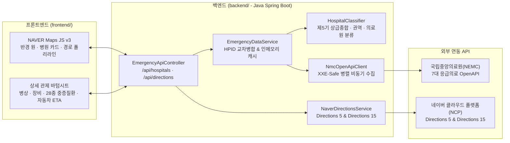

# 연세 119 응급실 정보 시스템 (Java Spring Boot + Vanilla Web Monorepo)

<div align="center">


**위치 기반 실시간 응급의료기관 최적 추천 · 다차원 의료 자원 인스펙션 · 네이버 자동차 경로(Directions 5/15) 관제 시스템**  
*저장소 명칭: `yonsei119` · 개발 팀명: `닥터피쉬 (Doctor Fish)`*

</div>

---

## 1. 모노레포(Monorepo) 디렉터리 구조

본 프로젝트는 GitHub 단일 저장소에서 `frontend/`와 `backend/`를 분리 관리하며, 빌드 및 Render 배포 시 단일 실행형 JAR로 통합 서빙되도록 설계된 모노레포입니다.

```text
yonsei119/
├── .idea/                         # IntelliJ IDEA 프로젝트/실행 구성 (Run/Debug 즉시 지원)
├── frontend/                      # 프론트엔드 (Modern HTML5 / CSS3 / ES2024+ Vanilla JS)
│   ├── Assets/                    # UI 아이콘 및 시스템 아키텍처 이미지 자산
│   ├── index.html                 # 네이버 지도 v3 + 반응형 관제 UI + Directions 5/15 시트
│   ├── style.css                  # 반응형 레이아웃 및 E-Gen 보드·경로 탐색 스타일시트
│   └── app.js                     # 네이버 지도 렌더링, 실시간 병상/질환 보드, 경로 폴리라인 엔진
├── backend/                       # 백엔드 (Java 17 + Spring Boot 4.1.2 + Gradle)
│   ├── build.gradle               # Spring Boot 의존성 및 frontend -> static 자동 패키징 태스크
│   └── src/
│       ├── main/
│       │   ├── java/com/yonsei119/
│       │   │   ├── Yonsei119Application.java         # Spring Boot 메인 진입점
│       │   │   ├── config/
│       │   │   │   ├── Yonsei119Properties.java      # 타입 안전 설정 바인딩 Record
│       │   │   │   └── WebConfig.java                # 정적 리소스(frontend/) 서빙 & CORS 설정
│       │   │   ├── controller/
│       │   │   │   └── EmergencyApiController.java   # /api/hospitals, /api/directions, /api/health
│       │   │   ├── dto/                              # 불변 Record DTO 계층
│       │   │   └── service/
│       │   │       ├── HospitalClassifier.java       # 제5기 상급종합병원(47개소)/권역/의료원 분류기
│       │   │       ├── NmcOpenApiClient.java         # XXE-Safe 7대 공공데이터 병렬 XML 수집기
│       │   │       ├── EmergencyDataService.java     # HPID 교차 병합 및 인메모리 TTL 캐시 서비스
│       │   │       └── NaverDirectionsService.java   # 네이버 Directions 5 & 15 경로/ETA 탐색 서비스
│       │   └── resources/
│       │       └── application.yml                   # 포트(${PORT:8080}), OpenAPI/NCP 설정
│       └── test/java/com/yonsei119/
│           └── Yonsei119BackendTests.java            # 백엔드 핵심 도메인 통합 테스트 (JUnit 5)
├── Dockerfile                     # Render 클라우드 배포용 멀티스테이지 Docker 빌드 정의
├── render.yaml                    # Render Blueprint 자동 배포 설정
├── settings.gradle                # Gradle 모노레포 루트 설정
└── build.gradle                   # 루트 빌드 단축 태스크 (bootRun, bootJar)
```

---

## 2. 핵심 아키텍처 및 주요 업그레이드 사항



### 주요 특징
1. **백엔드 중심 보안 및 성능 고도화**:
   - 기존 VanillaJS에 노출되어 있던 공공데이터포털 인증키(`API_KEY`)와 NCP Client Secret을 백엔드(`application.yml` / 환경변수)로 완전 격리했습니다.
   - 브라우저가 매번 7~9개의 대용량 XML을 개별 호출하던 구조를 백엔드 병렬 수집 + 인메모리 캐시(`45초 TTL`)로 전환하여 초기 로딩 속도를 획기적으로 단축했습니다.
2. **네이버 지도(NAVER Maps v3) + Directions 5 / Directions 15 통합**:
   - 병원 상세 시트에서 **Directions 5 (일반 빠른탐색)** 및 **Directions 15 (다중경유·광역)** 엔진과 탐색 옵션(`실시간 빠른길`, `실시간 최적`, `실시간 편한길`, `무료 우선`)을 선택하여 **예상 소요 시간(분), 실도로 주행거리(km), 통행료·택시비·유류비**를 조회하고 지도 위에 주행 경로 폴리라인을 즉시 표시합니다.
3. **현장 실사 도메인 규칙 & OpenAPI 명세서(V13) 전수 대조**:
   - **음수 병상 값(`< 0`)**: 오류나 0이 아닌 **'초과수용(Overcapacity)'** 상태로 판독하여 `초과수용 N/기준` 빨간색 배지로 표기합니다.
   - **결측치(`null` / 빈 문자열)**: 숫자 `0`(만실)과 엄격히 분리하여 `-`(미정보)로 표기합니다.
   - OpenAPI 활용가이드(V13) 더블체크를 통해 격리진료구역(`hv13`, `hv14`), 외상환자진료구역(`hv61`), 정형외과 입원실(`hv4`), 감염병 전담병상(`hv22`~`hv26`), 구급차 가용여부(`hvamyn`), 응급실 게이트키퍼(`mkioskty28`)까지 빠짐없이 반영했습니다.
4. **UI/UX 최적화**:
   - 초기 렌더링 성능을 위해 최초 접속 시 `'일반·기타'` 체크박스는 **기본 체크 해제** 상태로 시작합니다.
   - 좌측 상단의 `'530개 기관'` 문구를 제거하고, `'갱신 시간'` 배지를 우측 하단 검색 박스 내부의 **새로고침 버튼 우측**에 크기에 맞춰 통합 배치했습니다.

---

## 3. IntelliJ IDEA 로컬 실행 및 디버깅 방법

1. **IntelliJ IDEA**에서 프로젝트 루트 폴더(`C:\Users\rocky\IdeaProjects\yonsei119`)를 엽니다.
2. 우측 상단 실행 구성(Run Configuration)에 자동 등록된 **`Yonsei119Application (Spring Boot)`**을 선택하고 **실행(▶)** 또는 **디버그(🐞)** 버튼을 클릭합니다.
   - 또는 터미널에서 아래 명령어를 실행합니다:
     ```powershell
     .\gradlew.bat bootRun
     ```
3. 브라우저에서 `http://localhost:8080`으로 접속합니다.

---

## 4. Render 클라우드 배포 방법

본 저장소 루트에는 `Dockerfile`과 `render.yaml`이 포함되어 있어 Render에 즉시 배포할 수 있습니다.

1. GitHub 저장소에 프로젝트를 푸시합니다.
2. Render 대시보드에서 **New +** -> **Blueprint** (또는 **Web Service** -> **Build and deploy from a Git repository**)를 선택합니다.
3. Environment Variables에 아래 값을 설정합니다 (설정하지 않아도 기본 키로 동작하도록 폴백이 구성되어 있습니다):
   - `NAVER_MAP_CLIENT_ID`: `xfbxloc8km`
   - `NAVER_MAP_CLIENT_SECRET`: *(NCP Application Client Secret)*
   - `NEMC_API_SERVICE_KEY`: *(공공데이터포털 일반 인증키)*
4. Render가 자동으로 `./Dockerfile`을 빌드하여 `$PORT` 바인딩 및 `/api/health` 헬스체크와 함께 서비스를 구동합니다.
